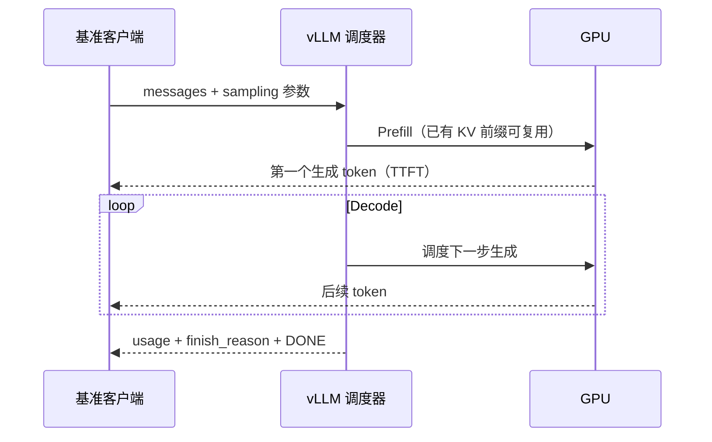

# 结合任务二学习 vLLM

vLLM 是大模型**推理与服务引擎**。模型决定生成什么，vLLM 管理 GPU 上怎样执行、如何安排多个请求，以及怎样保存和复用注意力状态。这个项目主要研究推理服务，不做模型训练。

## 先理解一次请求

**Prefill** 处理输入 prompt，计算各层 Key/Value；输入越长，待处理内容通常越多。**Decode** 在已有 KV 上继续生成新 token。TTFT 包含网络、排队、输入处理以及第一个生成步骤；输出 token/s 还受输出长度、并发和调度影响。因此 TTFT 更低不自动意味着所有吞吐量指标都会更高。

对应实验：先跑并发 1，读 `run_log.jsonl` 中 `timing_ms`、`usage` 和 `stream_chunks`，再与并发 4/8 比较。同样的 GPU 请求更多时可能提高总体吞吐量，也可能增加单请求排队延迟。用数据观察取舍，不预设结论。

## KV Cache 与 PagedAttention

KV Cache 保存已经计算过的注意力 Key/Value，避免 Decode 每一步都重算全部历史。它占用显存；长上下文和多个同时运行的会话都会加大需求。PagedAttention 用分块方式管理这些状态，减少预留与碎片造成的浪费，并支持块共享。它属于内存管理机制。

Automatic Prefix Caching（APC）进一步在请求间复用完全匹配的前缀 KV。它和 PagedAttention 有联系，但开启 APC 是单独的配置，不能把一般 KV Cache 的存在当成 APC 已开启。

建议阅读原论文：[Efficient Memory Management for Large Language Model Serving with PagedAttention](https://arxiv.org/abs/2309.06180)，再对照 [vLLM APC 文档](https://docs.vllm.ai/en/stable/features/automatic_prefix_caching/)。

## Continuous Batching

推理请求的输入与输出长度并不相同。vLLM 持续在执行过程中安排可运行请求，使完成的请求退出、后续请求进入，尽量利用 GPU。实际表现还受显存、调度上限和其他负载影响。

对应配置：`max_num_seqs`、`max_model_len`、`gpu_memory_utilization`；对应实验：相同模型、固定输入、并发 1/4/8。先学会区分“每秒完成多少请求”和“每个请求要等多久”，再考虑调参。

## T4、AWQ 与本次配置

本次候选使用单张 T4 16GB 和 `Qwen2.5-7B-Instruct-AWQ`。Qwen 官方 checkpoint 的 AWQ 配置为 4-bit、group size 128，计算 dtype 为 FP16。权重压缩后为 KV cache 和运行时留出更多空间，但是否支持目标上下文和并发，仍要看 vLLM 启动时报告的容量与真实请求结果。[官方模型配置](https://huggingface.co/Qwen/Qwen2.5-7B-Instruct-AWQ/blob/b25037543e9394b818fdfca67ab2a00ecc7dd641/config.json)

区分三件事：AWQ 压缩模型权重；KV cache 保存本次推理的注意力状态；APC 让请求之间复用相同前缀的 KV。`--quantization awq` 不会自动把 KV cache 变成 4-bit，也不代表 APC 已开启。本项目保持相同的 AWQ 模型和计算精度，只在受控实验中切换 APC。

T4 属于 Turing，不能直接套用 BF16 或要求 Ampere 的 FlashAttention 配置。当前候选显式选择 FP16、`TRITON_ATTN` 与 eager 执行；这些参数也必须交给任务三、四统一，不能只看模型名相同就合并结果。eager 是本次试跑的执行方式，不代表它已经达到最佳性能。[vLLM 量化支持](https://docs.vllm.ai/en/stable/features/quantization/)、[attention backend 支持](https://docs.vllm.ai/en/v0.34.0/design/attention_backends/)

## 为什么主动场景适合研究前缀缓存

任务一 prompt 只在尾部追加历史，旧的 system、观测和工具结果可以形成重复前缀。APC 命中时可省去相同前缀的部分 Prefill 工作。它主要节省输入处理，不会替模型生成后续输出。

真正命中依赖分词后的前缀、块边界、服务端状态以及缓存是否被逐出。客户端计算的“共享字节比例”只是结构上的复用潜力，不能替代服务端 `cached_tokens` 或 prefix-cache metrics；统计缺失应保留 null。

最有价值的实验顺序：先跑一个主动场景 OFF 与 ON，检查行为是否一致；再导出同一批请求做固定重放，隔离工作负载变化。正式开启/关闭用 `task2.serve`，不是只改客户端标签。

## 学习顺序与具体练习

| 阶段 | 读代码/文档 | 动手目标 |
| --- | --- | --- |
| 1. 服务入门 | [OpenAI-compatible Server](https://docs.vllm.ai/en/stable/serving/openai_compatible_server/)；`task2/serve.py` | 启动固定模型，检查 `/v1/models`、版本与服务日志 |
| 2. 性能口径 | `task2/client.py`、`task2/benchmark.py` | 明确首 token、完整响应、usage、失败的区别 |
| 3. 显存与调度 | PagedAttention 论文、`configs/baseline.json` | 解释上下文与并发如何影响 KV 容量和延迟 |
| 4. 缓存实验 | APC 文档；任务一的 `framework/prompt.py` | 证明 OFF/ON 请求相同，确认服务端缓存开关与命中统计 |
| 5. 性能定位 | [Profiling vLLM](https://docs.vllm.ai/en/latest/contributing/profiling/)；`task2/trace_summary.py` | 在真实 trace 中看 CPU、GPU 和等待区间，解释耗时证据 |

任务二交付后的学习成果应是：你能启动可复现的服务、说明每个性能数字怎么测出来、读懂一个真实 trace，并解释 APC 什么时候可能有收益。仓库已提供 [T4 实测数据与真实 GPU trace](../results/colab-t4-20261119/README.md)，可对照阅读。当前只有 APC OFF，不能得出缓存加速比例；Prefill/Decode 瓶颈判断仍须结合具体时间线和请求标识。
